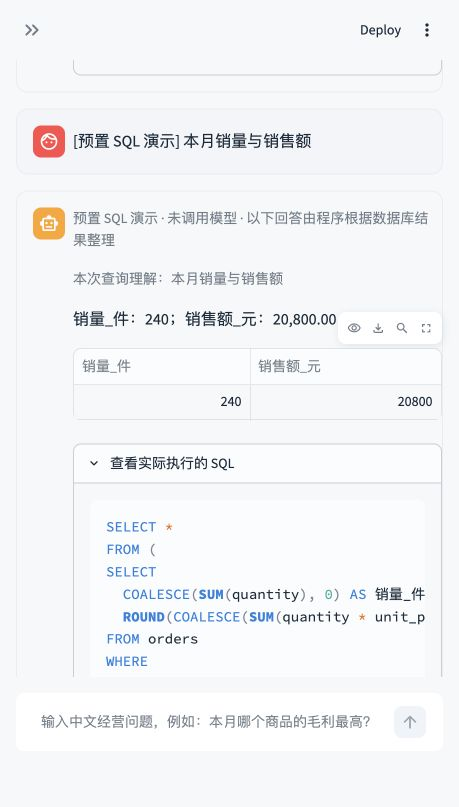
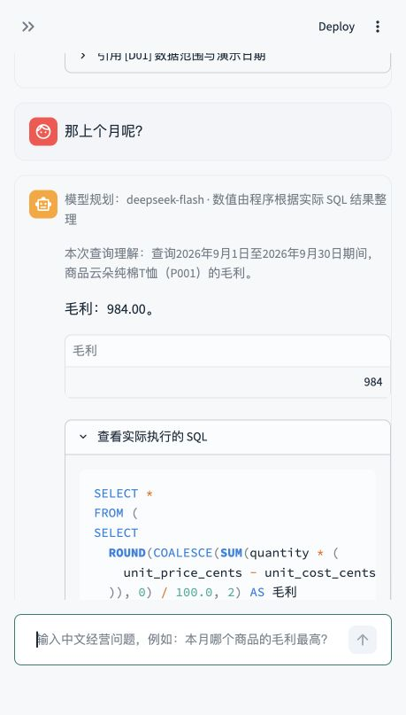
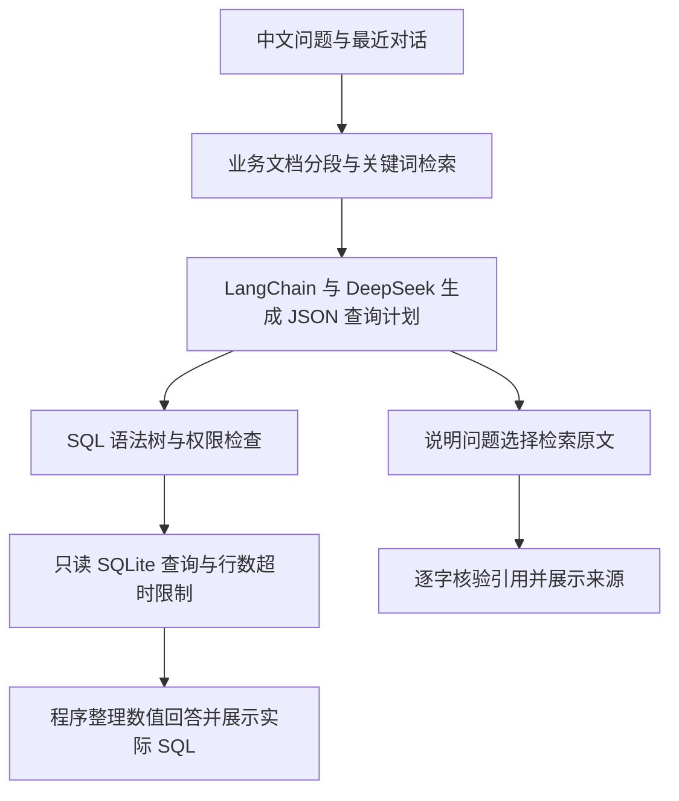

# 电商商家经营数据问答 Agent

用中文查询销量、销售额、库存与毛利，并查看实际执行的 SQL 和业务说明引用。

**技术栈：Python · Streamlit · SQLite · LangChain · DeepSeek API**

这是一个可在本机运行的学习与作品展示项目。全部订单、商品、库存均为程序生成的**虚构演示数据**。开发过程使用 AI 编程助手辅助实现，验证包括自动测试与真实 DeepSeek API 调用。

[真实模型验收记录](reports/真实模型验收.md) · [20 道问题与标准答案](docs/20道验收问题与标准答案.md) · [业务指标说明](docs/业务指标说明.md)

## 解决的问题

商家查看经营数据时，需要在订单、商品与库存之间关联计算，还要正确处理取消退款、成交成本和库存占用。本项目把中文问题转换为受约束的 SQL 查询，让结果可以追溯到实际语句和明确的业务口径。

| 能力 | 示例 |
|---|---|
| 中文转 SQL | 本月总销量、销售额和毛利分别是多少？ |
| 连续追问 | 本月云朵纯棉T恤销售额 → 它的毛利呢 → 那上个月呢 |
| 库存查询 | 哪些商品触发低库存预警？ |
| 文档检索与引用 | 毛利应使用历史成本还是当前成本？ |
| 明确说明缺失信息 | 广告 ROI 目标没有文档依据时不编造 |
| 只读防护 | 拒绝删除、修改、系统表查询和危险函数 |

## 实际运行效果

### 无需密钥的预置 SQL 演示

下面结果来自程序执行预置 SQL，页面明确标注“未调用模型”。



### 真实模型连续追问

下面截图来自真实 DeepSeek 调用：用户追问“那上个月呢”，程序继承商品与毛利指标，将日期切换为 2026 年 9 月，得到毛利 984 元。



## 查询流程



数值回答来自数据库查询结果。说明回答使用检索段落中的连续原句，程序核验引用存在且逐字一致后才展示。模型无法访问终端、读取任意文件或写入数据库。

## 实测与验收

记录于 **2026-10-20**，详细结果可查看随仓库附带的验收记录：

- **42 项本地自动测试通过**，覆盖 SQL 防护、超时、截断、上下文传递、引用核验与错误提示。
- **20/20 道真实模型在线验收通过**，包括 16 道数值题、2 道文档题、缺失依据和拒绝删除。
- 在真实浏览器中验证了三轮连续追问，并核对结果表与实际 SQL。

| 连续输入 | 标准结果 |
|---|---|
| 本月云朵纯棉T恤的销量和销售额是多少？ | 30 件；2,280.00 元 |
| 它的毛利呢？ | 本月同一商品毛利 1,185.00 元 |
| 那上个月呢？ | 2026 年 9 月同一商品毛利 984.00 元 |

本次验收覆盖当前演示数据和题集；模型、数据或业务口径变化后需要重新验证。自动测试中的模型夹具与真实在线验收分别标注，不会在正常页面中用固定答案冒充模型输出。

## 本地运行

建议使用 Python 3.12。在项目根目录打开终端，依次运行：

```bash
python3 -m venv .venv
source .venv/bin/activate
python -m pip install -r requirements.lock.txt
cp .env.example .env
chmod 600 .env
python -m merchant.seed
python -m streamlit run app.py --server.address 127.0.0.1
```

然后打开终端显示的本机页面地址。在 Mac 上，也可以在项目根目录运行 `zsh 启动.command`。

**没有 API 密钥也能查看演示数据、运行预置 SQL 和本地文档检索。**自由中文提问与连续追问需要使用者自行配置真实 DeepSeek API 密钥；未配置或调用失败时页面会明确提示。

在本地 `.env` 中配置：

```dotenv
DEEPSEEK_API_KEY=
DEEPSEEK_BASE_URL=https://api.deepseek.com
DEEPSEEK_MODEL=deepseek-flash
API_TIMEOUT_SECONDS=45
SQL_TIMEOUT_SECONDS=2
MAX_RESULT_ROWS=100
```

密钥留空处填写自己的真实密钥；模型名称以账号实际支持的模型为准。保存后在页面侧栏点击“重新读取配置”。仓库不包含作者的密钥。真实调用会使用配置账号的 API 额度。

## 数据与业务口径

- SQLite 包含 `orders`（96 条明细）、`products`（6 个商品）、`inventory`（6 行快照）三张表。
- 订单日期覆盖 2026 年 7—10 月，演示相对日期固定参照 **2026-10-20**，与实际访问日期无关。
- 有效成交只包括 `paid`、`completed`，排除取消和全额退款。
- 金额以整数分存储；销售额和毛利展示为元，毛利用订单成交时的历史单位成本。
- 可售库存等于账面库存减占用库存；仅有 2026-10-20 单日快照。

## 防护与当前边界

数据库连接使用 `mode=ro` 和 `query_only`，查询先经 SQL AST 检查，再通过三表、字段和函数白名单约束。执行时增加外层行数限制，结合进度回调与中断计时器限制耗时。界面最多显示 100 行，并明确提示截断。

文档按标题分段，长段上限 450 字、重叠 60 字，通过中文关键词、双字词和指标同义词检索。当前没有向量数据库、嵌入服务或自动 SQL 修复功能。缺少历史库存、费用表、广告 ROI、真实客户和未来预测数据；本项目不声称具备生产环境部署能力。

当前提供的是**源代码与本机演示**。GitHub 仓库页面本身不运行 Python 后端。

## 验证命令

```bash
# 不调用真实模型
python -m pytest tests -q
python -m merchant.acceptance

# 使用自己的密钥进行真实在线验收，会产生 API 用量
python -m merchant.acceptance --live
```

## 文件导航

| 文件 | 用途 |
|---|---|
| `app.py` | Streamlit 聊天页面、表格、SQL 和引用展示 |
| `merchant/agent.py` | LangChain 查询规划、接口调用、文档引用核验 |
| `merchant/database.py` | SQL 校验、只读执行、截断与超时 |
| `merchant/memory.py` | 最近成功查询的上下文传递 |
| `merchant/retrieval.py` | 业务文档分段与中文关键词检索 |
| `merchant/seed.py` | 确定性演示数据生成 |
| `tests/` | 本地自动测试 |
| `docs/` | 业务口径、验收题与标准答案 |
| `reports/` | 验收记录与实际在线结果 |
